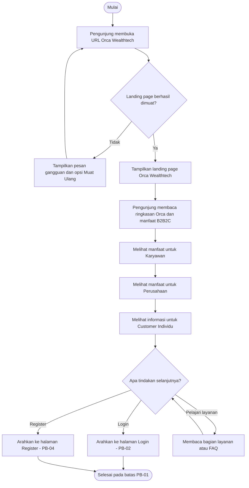

# User Flow: Landing Page (PB-01)

## 1. Informasi Fitur
- **Produk:** Orca Wealthtech
- **Product Backlog:** PB-01
- **Prioritas:** High
- **Kategori MVP:** MVP - Must Have
- **Aktor:** Pengunjung (calon karyawan, perwakilan perusahaan, dan customer individu)
- **Tujuan:** Membantu pengunjung memahami Orca sebagai platform wealthtech B2B2C, mengenali manfaat berdasarkan perannya, lalu melanjutkan ke Login atau Register.

## 2. User Story
As a pengunjung (calon karyawan, perwakilan perusahaan, atau customer individu), I want to melihat landing page yang menjelaskan Orca Wealthtech dan pilihan layanan berdasarkan peran saya, so that saya memahami manfaat Orca dan dapat melanjutkan ke proses yang sesuai.

## 3. Precondition
1. Pengunjung dapat membuka URL Orca Wealthtech melalui browser.
2. Pengunjung tidak perlu memiliki akun atau login untuk melihat landing page.
3. Halaman hanya menampilkan informasi umum, bukan data pribadi atau portofolio pengguna.

## 4. Main Flow
1. Pengunjung membuka URL Orca Wealthtech.
2. Sistem memuat landing page.
3. Sistem menampilkan identitas dan ringkasan Orca sebagai platform wealthtech B2B2C.
4. Pengunjung membaca penjelasan layanan dan manfaat Orca.
5. Pengunjung melihat manfaat untuk tiga kelompok pengguna:
   - **Karyawan:** akses ke program investasi berkala melalui perusahaan yang berpartisipasi.
   - **Perusahaan:** dukungan program kesejahteraan finansial karyawan dan ringkasan partisipasi secara agregat.
   - **Customer Individu:** informasi layanan yang tersedia untuk pengguna individu beserta batasan aksesnya.
6. Pengunjung dapat membaca bagian layanan atau FAQ.
7. Sistem menyediakan tombol **Login** dan **Register**.
8. Jika memilih Login, sistem mengarahkan ke halaman Login (PB-02).
9. Jika memilih Register, sistem mengarahkan ke halaman Register (PB-04).
10. Alur PB-01 selesai saat pengunjung meninggalkan landing page menuju Login/Register atau selesai membaca informasi.

## 5. Alternative Flow dan Error Flow

### AF-01 - Membaca informasi lebih lanjut
1. Pengunjung memilih bagian layanan atau FAQ.
2. Sistem menampilkan informasi tambahan.
3. Pengunjung kembali ke navigasi utama dan memilih Login/Register, atau mengakhiri kunjungan.

### AF-02 - Memilih Login
1. Pengunjung menekan tombol Login.
2. Sistem mengarahkan ke halaman Login (PB-02).
3. Autentikasi berada di luar cakupan PB-01.

### AF-03 - Memilih Register
1. Pengunjung menekan tombol Register.
2. Sistem mengarahkan ke halaman Register (PB-04).
3. Pemilihan jenis akun Karyawan, Perusahaan, atau Customer Individu dilakukan pada PB-04, bukan di PB-01.

### EF-01 - Landing page gagal dimuat
1. Pengunjung membuka URL Orca.
2. Sistem gagal memuat halaman karena gangguan jaringan/server.
3. Sistem menampilkan pesan gangguan dan opsi Muat Ulang.
4. Pengunjung memilih Muat Ulang untuk mencoba kembali.

## 6. Diagram User Flow
Diagram berikut menggunakan Mermaid sesuai panduan materi. GitHub dapat merender diagram ini langsung dari Markdown.

## 7. Acceptance Criteria
1. **Akses publik**
   - Given pengunjung belum login, When membuka URL Orca, Then landing page dapat diakses tanpa autentikasi.
2. **Informasi Orca**
   - Given landing page berhasil dimuat, When pengunjung melihat halaman, Then identitas dan ringkasan Orca sebagai platform wealthtech B2B2C ditampilkan.
3. **Informasi B2B2C**
   - Given pengunjung membaca bagian manfaat, When melihat konten, Then tersedia penjelasan untuk Karyawan, Perusahaan, dan Customer Individu.
4. **Navigasi Login**
   - Given pengunjung berada di landing page, When memilih Login, Then sistem mengarahkan ke PB-02.
5. **Navigasi Register**
   - Given pengunjung berada di landing page, When memilih Register, Then sistem mengarahkan ke PB-04.
6. **Responsif**
   - Given pengunjung menggunakan desktop atau mobile, When membuka landing page, Then konten dan navigasi tetap terbaca dan dapat digunakan.
7. **Penanganan error**
   - Given halaman gagal dimuat, When sistem mendeteksi gangguan, Then pesan gangguan dan opsi Muat Ulang ditampilkan.

## 8. Batasan Scope PB-01
**Termasuk:**
- Halaman publik pengenalan Orca Wealthtech.
- Penjelasan manfaat untuk Karyawan, Perusahaan, dan Customer Individu.
- Navigasi ke Login (PB-02) dan Register (PB-04).
- Informasi layanan/FAQ.
- Tampilan responsif dan penanganan kegagalan pemuatan.

**Tidak termasuk:**
- Autentikasi dan pengelolaan sesi (PB-02).
- Formulir pendaftaran dan pemilihan jenis akun (PB-04).
- Dashboard karyawan/perusahaan.
- Instruksi investasi, pemotongan payroll, atau transaksi investasi.
- Janji imbal hasil atau rekomendasi investasi.

## 9. Handoff ke Role Tim
- **System Analyst:** memastikan alur konsisten dengan PRD dan backlog.
- **UI/UX Designer:** menerjemahkan langkah menjadi section/komponen landing page dan wireframe. User flow bukan pengganti wireframe.
- **Developer/Vibe Coder:** membangun route landing page, tautan Login/Register, layout responsif, dan tampilan error.
- **QA:** menguji alur utama, kedua jalur navigasi, tampilan desktop/mobile, serta error pemuatan.

## 10. Asumsi
1. Landing page bersifat publik.
2. Landing page menjelaskan tiga kelompok pengguna, tetapi tidak membuat akun atau memverifikasi identitas.
3. Jenis akun dipilih pada proses Register (PB-04).
4. Alur setelah pengunjung masuk ke Login/Register berada di luar cakupan PB-01.
5. Konten tidak boleh menjanjikan hasil investasi atau menyiratkan Orca sebagai pengelola dana/APERD.

## 11. Referensi
- Product Backlog Orca Wealthtech: PB-01 Landing Page.
- Panduan Proyek Scrum: materi User Flow (halaman 17-21): pengertian flow, simbol flowchart, relasi dengan PRD/user story/acceptance criteria, dan sintaks Mermaid.
